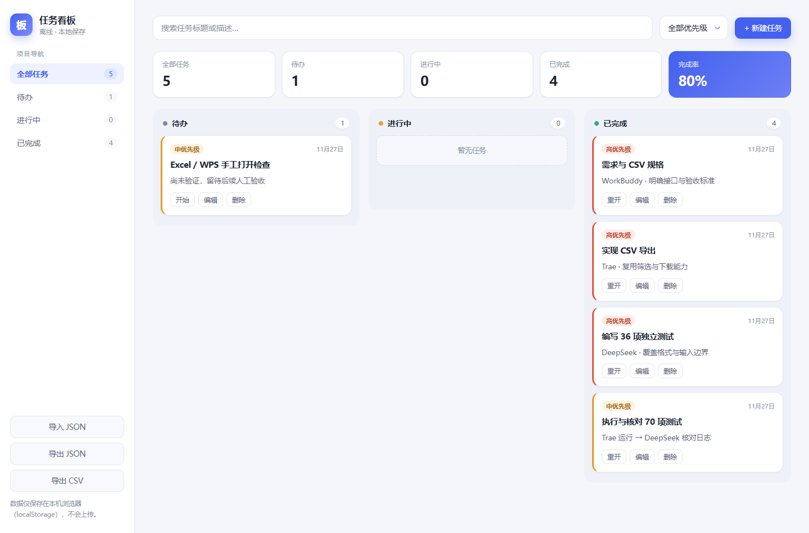

# CustomBot

**把不同的 AI 工具拉进一个群，一起完成一个项目。**

[繁體中文](docs/README.zh-TW.md) · [English](docs/README.en.md)

CustomBot 是基于 OpenMausBot 的 Windows 桌面助手工作台。保留主助手、自定义助手、项目群聊、知识与记忆，用一个界面组织本机 AI 工具的分工与交接。

## 看一次真实协作

演示任务：为离线任务看板开发 CSV 导出。截图来自运行中的应用与真实工具回复，展示群汇报实际开发结果；不是模拟引擎生成的成功记录。

| 成员 | 负责什么 | 实际交付 |
| --- | --- | --- |
| WorkBuddy | 需求规格、代码评审 | 三语规格、评审与歧义澄清 |
| Trae | 开发、执行与修复 | CSV 功能、测试执行日志 |
| DeepSeek | 独立测试、核对结果 | 36 项 CSV 测试、三语验收报告 |

**70 项自动化测试通过：34 项原有回归 + 36 项 CSV 测试。** DeepSeek 的本机 shell 被 Windows ACL 拦截后，主动将运行任务交给 Trae，随后读取原始日志核对结果。协调者另行复跑 70 项测试，并完成真实 Chrome 中的下载、筛选、中文转义和窄窗口检查。

[查看测试原始输出](docs/media/csv-test-results.txt) · [查看协作过程与边界](docs/showcase.zh-CN.md)

## 项目成果

成果截图使用隔离浏览器中的验收样例数据。应用支持任务增删改、状态与优先级筛选、搜索、本地保存、JSON 导入导出，以及当前筛选结果的 CSV 导出。

## 你可以做什么

- **主助手**：通过对话创建助手、组织项目与分工。
- **自定义助手**：选择模型，编辑系统提示词、MCP、Skill 与权限。
- **项目群聊**：让不同工具围绕同一目录协作，查看消息、工具活动、交接与结果。
- **知识与记忆**：导入 TXT / Markdown，查看关系图谱并打开、编辑记忆；图谱可收起。

## 当前状态

Windows 本机预览阶段。本页发布的是演示与验收材料，不是安装包或完整源码发行说明。

WorkBuddy 使用本机原生 CLI；DeepSeek 使用本机 Harness；Trae 使用实验性桌面桥接，依赖已打开的特定工作区与桌面结构，并非官方 traecli 集成。初始任务由协调者分阶段派发，后续交接由群成员完成；原生审批仍可能需要人工处理。本机运行不等于离线，账号登录、服务额度和网络仍会影响执行。Excel/WPS 实际打开 CSV 尚未验证。

## 来源与标识

基于 [OpenMausBot](https://github.com/milind-soni/OpenMausBot)。第三方名称及截图中的图标仅用于标识所连接工具，归各自权利人所有，不表示官方合作或背书。图标复用本机已安装应用的资源；没有将第三方品牌作为 CustomBot 自有标识。
