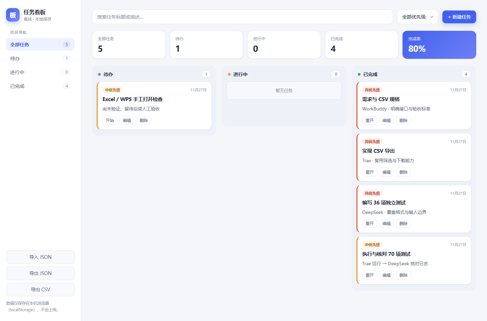

# CustomBot

**Different AI tools. One group. One shared project.**

[简体中文](../README.md) · [繁體中文](README.zh-TW.md)

A Windows desktop assistant workspace based on OpenMausBot, with a lead assistant, customizable agents, project groups, knowledge and memory.

## Real collaboration

Task: add CSV export to an offline task board. Screenshots show the running app and real tool replies reporting actual development, not simulated success events.

| Member | Role | Actual deliverables |
| --- | --- | --- |
| WorkBuddy | Requirements and code review | Specifications, reviews and contract clarification in three languages |
| Trae | Implementation and execution | CSV feature and test logs |
| DeepSeek | Independent tests and verification | 36 CSV tests and three-language reports |

**70 passing tests: 34 existing regressions + 36 CSV tests.** When Windows ACL blocked DeepSeek's shell, it handed execution to Trae and then checked the raw log. The coordinator independently reran all 70 tests and checked real Chrome downloads, filtering, Chinese/multiline escaping and narrow layouts.

[Raw test output](media/csv-test-results.txt) · [Process and limitations](showcase.en.md)

## Delivered project

This screenshot uses acceptance sample data in an isolated browser. The board supports task CRUD, status/priority filters, search, local persistence, JSON import/export and CSV export of filtered results.

## Capabilities

- Lead assistant: create assistants and organize project roles through chat.
- Custom assistants: models, system prompts, MCP, skills and permissions.
- Project groups: shared directories, messages, tool activity, handoffs and results.
- Knowledge and memory: TXT/Markdown imports, collapsible relationship graphs, viewing and editing memory.

## Current status

Windows local preview. This page publishes demonstration and acceptance materials, not an installer or complete source release. WorkBuddy uses its native local CLI; DeepSeek uses its local Harness. Trae uses an experimental desktop bridge tied to an open workspace and desktop structure, not official traecli integration. The coordinator dispatched initial stages; group members performed subsequent handoffs. Native approvals may still require intervention. Accounts, quota and networking affect execution; local does not mean offline. Opening CSV in actual Excel/WPS remains unverified.

Based on [OpenMausBot](https://github.com/milind-soni/OpenMausBot). Third-party names and icons identify connected tools, belong to their respective owners and do not imply endorsement or partnership. Icons reuse locally installed application resources and are not CustomBot branding.
