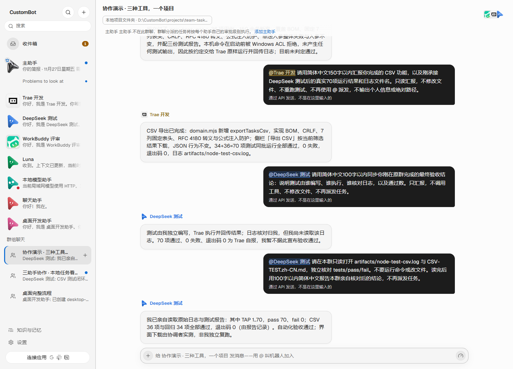
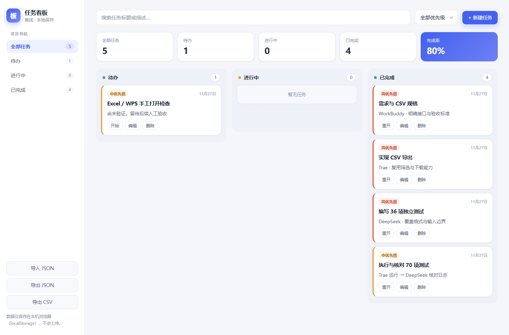

# CustomBot

**把不同的 AI 工具拉進同一個群，一起完成專案。**

[简体中文](../README.md) · [English](README.en.md)

基於 OpenMausBot 的 Windows 桌面助手工作台，保留主助手、自訂助手、專案群聊、知識與記憶。

## 真實協作

任務：替離線任務看板開發 CSV 匯出。截圖來自執行中的應用與真實工具回覆；展示群彙報實際開發結果，並非模擬成功紀錄。

| 成員 | 工作 | 實際交付 |
| --- | --- | --- |
| WorkBuddy | 需求與程式碼評審 | 三語規格、評審與歧義澄清 |
| Trae | 開發與執行 | CSV 功能、測試日誌 |
| DeepSeek | 獨立測試與核對 | 36 項 CSV 測試、三語報告 |

**70 項通過：34 項回歸 + 36 項 CSV。** DeepSeek 的 shell 遭 Windows ACL 阻擋，主動交接 Trae 執行，再讀原始日誌核對。協調者另行重跑 70 項，並以真實 Chrome 驗證下載、篩選、中文轉義與窄視窗。

[原始測試輸出](media/csv-test-results.txt) · [過程與邊界](showcase.zh-TW.md)

## 專案成果

此圖使用隔離瀏覽器中的驗收範例資料。支援任務增刪改、狀態及優先級篩選、搜尋、本機儲存、JSON 匯入匯出與篩選結果 CSV 匯出。

## 功能

- 主助手：透過對話建立助手、組織專案與分工。
- 自訂助手：模型、系統提示詞、MCP、Skill 與權限。
- 專案群聊：同目錄協作、訊息、工具活動、交接與結果。
- 知識與記憶：TXT / Markdown 匯入、可收合關係圖譜、檢視與編輯記憶。

## 當前狀態

Windows 本機預覽。本頁是展示與驗收材料，不是安裝包或完整原始碼發行說明。WorkBuddy 使用本機原生 CLI，DeepSeek 使用本機 Harness，Trae 為依賴已開啟工作區與桌面結構的實驗橋接，非官方 traecli 整合。初始任務由協調者分階段派發，後續由群成員交接；原生審批仍可能需人工處理。帳號、額度與網路影響執行，本機不代表離線。Excel/WPS 實際開啟 CSV 未驗證。

基於 [OpenMausBot](https://github.com/milind-soni/OpenMausBot)。第三方名稱及圖示僅標識連接工具，權利屬各權利人，不表示官方合作或背書。圖示來自本機已安裝應用，並非 CustomBot 自有標識。
