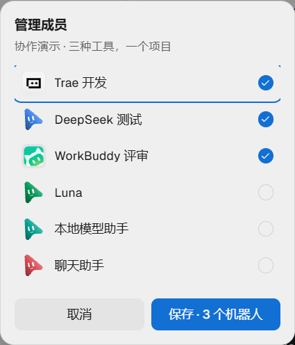

# CustomBot · CSV collaboration

Final outcome: the three tools completed this CSV task. Later DeepSeek requests worked; it authored 36 tests and handed execution to Trae via coordinate_bots. Trae ran all 70 successfully; DeepSeek read the log and updated its reports. The coordinator independently reran all 70 successfully. Earlier insufficient balance was an intermediate event, not the final blocker.

Flow: WorkBuddy specification → Trae implementation → WorkBuddy review/clarification → DeepSeek tests → Trae execution → DeepSeek log verification.

Validation: 70 business tests, 7 coordinator CSV checks, 62 existing icon tests, 5 completion-detection tests and 6 ACP protocol checks; real Chrome acceptance passed.

Limits: experimental local adapters; native approvals required coordinator intervention. DeepSeek shell has an ACL restriction, handled by handing execution to another member. Excel/WPS untested. Earlier incomplete-status replies in the showcase reflect their point in time.

Only introduction materials and sanitized test output are published, without installers or account configuration.

[Raw test log](media/csv-test-results.txt)

