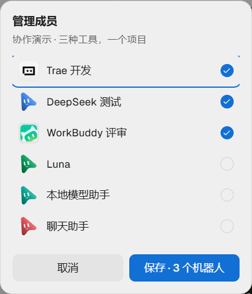

# CustomBot · CSV collaboration

最新结果：三方协作已经完成本轮 CSV 任务。DeepSeek 后续请求恢复，写出36项测试并通过 coordinate_bots 交接 Trae；Trae 执行70项全部通过，DeepSeek 回读日志更新三语报告。协调者独立复跑70项通过。早先余额不足是中间事件，不再是本轮最终阻塞。

流程：WorkBuddy 规格 → Trae 实现 → WorkBuddy 评审/澄清 → DeepSeek 测试 → Trae 执行 → DeepSeek 核对日志。

验证：70项业务测试、7项协调者CSV边界检查、62项既有图标测试、5项完成识别测试、6项ACP协议检查；真实Chrome验收通过。

限制：本机实验性适配；原生审批需要协调者处理；DeepSeek shell存在ACL限制，通过成员交接完成执行。Excel/WPS未实测。截图展示群中的汇报有先后顺序，早期“未完成”反映当时状态。

本次仅发布图文介绍和脱敏测试输出，无安装包、无账号配置。

[Raw test log](media/csv-test-results.txt)

