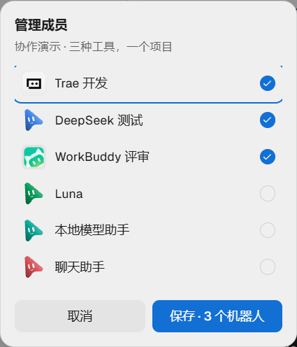

# CustomBot · CSV collaboration

最新結果：三方完成本輪 CSV 任務。DeepSeek 後續請求恢復，編寫36項測試並透過 coordinate_bots 交接 Trae；Trae 執行70項全過，DeepSeek 回讀日誌更新三語報告。協調者獨立重跑70項通過。早先額度不足是中間事件，已非最終阻塞。

流程：WorkBuddy 規格 → Trae 實作 → WorkBuddy 評審/澄清 → DeepSeek 測試 → Trae 執行 → DeepSeek 核對日誌。

驗證：70項業務測試、7項協調者CSV邊界檢查、62項既有圖示測試、5項完成識別、6項ACP協議；真實Chrome驗收通過。

限制：本機實驗適配，原生審批需協調者處理；DeepSeek shell有ACL限制，由成員交接執行。Excel/WPS未實測。展示群的早期未完成回覆反映當時狀態。

僅發布圖文介紹與去識別測試輸出，無安裝包或帳號設定。

[Raw test log](media/csv-test-results.txt)

